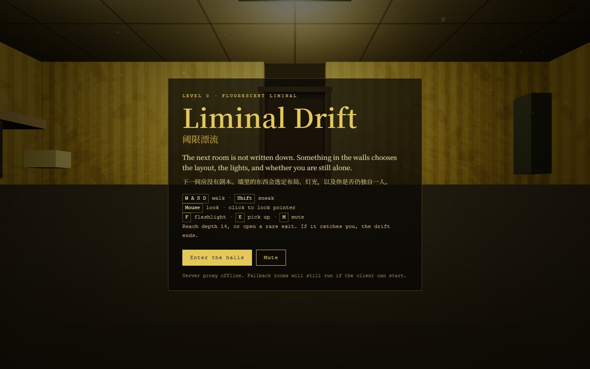
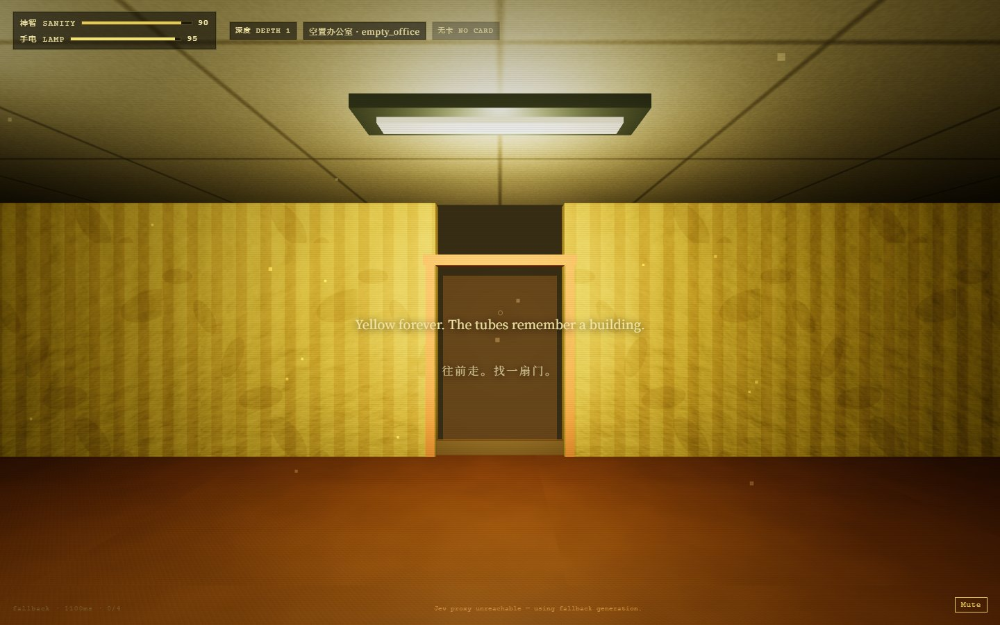

# 阈限漂流 · Liminal Drift

一款第一人称后室探索与逃生原型。在泛黄的办公室、走廊和潮湿空间中寻找下一扇门，管理神智与手电，避开追踪你的实体。

## 游戏画面

2026-10-12 本地 fallback 模式实机画面；截图时没有运行模型代理，画面保留对应状态提示。





## 已实现玩法

- 程序化房间、门与连接走廊；包含办公室、迷宫、积水区域和池核空间。
- 电池、钥匙卡、纸条等拾取物，以及手电消耗、神智压力和实体行为。
- 到达深度 14，或满足条件打开稀有出口即可胜利；被实体捕获则失败。
- 可选 TypeSafe Jev 结构化决策；无密钥、超时或代理不可达时继续使用 fallback。

| 操作 | 输入 |
| --- | --- |
| 移动 / 潜行 | WASD / Shift |
| 观察 | 鼠标；点击可锁定指针，未锁定也可移动 |
| 手电 / 拾取 | F / E |
| 静音 | M |

## 本地运行

本次验证环境为 Node.js 24.15.0 和 npm。先安装锁定依赖，再仅启动前端即可体验不调用模型的 fallback：

```sh
npm ci --ignore-scripts
npm run dev -w client -- --host 127.0.0.1
```

打开 <http://127.0.0.1:43133/>，点击 **Enter the halls**。未启动代理时会显示离线提示，但可以进入并移动。

需要运行本机决策代理时，在另一个终端执行 `npm run dev:server`，默认端口为 43134；也可用 `npm run dev` 同时启动两端。代理没有 `TYPESAFE_API_KEY` 时仍采用规则 fallback。可选模型配置见 [.env.example](.env.example)，只在服务端设置密钥，模型访问和费用需自行确认。

```sh
npm run build
npm run preview -w client -- --host 127.0.0.1
```

构建输出为 `client/dist/`。2026-10-12 已验证安装、客户端 fallback 启动、第一人称移动和构建通过；没有验证付费模型或线上部署。项目还提供 `npm test` 与 `npm run typecheck`。

## 技术栈

Three.js、TypeScript、Vite；Hono / Node.js 提供可选代理。`client/` 负责游戏与界面，`server/` 负责 Jev 调用，`shared/` 负责类型、决策映射与确定性 fallback。

Jev 使用 Choice / Score / Noul 返回房间与实体的结构化选择，不生成游戏美术或任意代码。客户端预取房间，失效字段单独回退。

## 当前限制

当前为单人原型，没有账号系统或多人模式。截图展示 fallback，不代表真实 Jev 模型已经可用。房间规模、实体行为、触屏体验与设备性能仍需持续试玩验证。构建有较大前端资源包提示。

## 素材与参考

场景几何、纹理与声音主要由项目代码中的 `client/src/game/textures.ts`、场景模块和 `client/src/audio.ts` 程序生成。页面通过 Google Fonts 请求 Cormorant Garamond、IBM Plex Mono 和 Noto Serif SC；离线时使用后备字体，字体许可仍归各字体项目。

美术打磨参考花间莉萝的视频 [《为什么你的独立游戏充满廉价感？》](https://www.bilibili.com/video/BV1q843z1EgF)，保留原有归属说明。

## 许可证

本项目自有代码采用 [MIT 许可证](LICENSE)。第三方代码、依赖、字体及素材保留其原有条款，参见 [NOTICE.md](NOTICE.md)；代码许可证不把第三方素材重新授权为 MIT。
